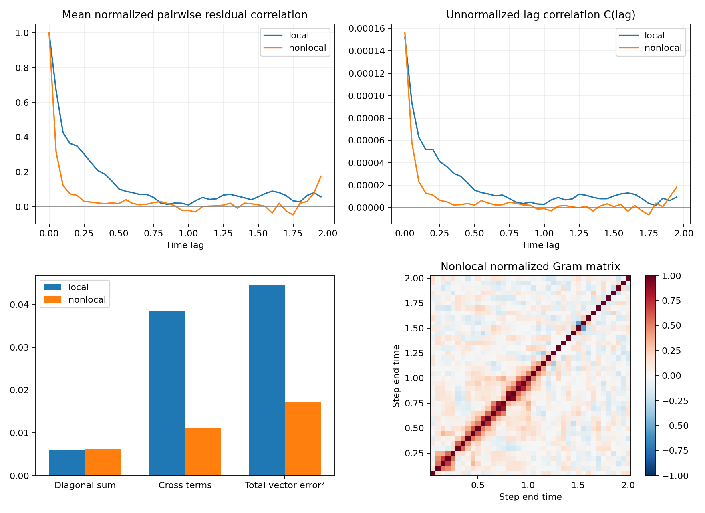

# Local / nonlocal transported residual correlation, t=0..2

Both trajectories use midpoint Suzuki2 reps2, dt=.05, Neel input, identical L-BFGS-B and local-cost acceptance, with no penalties. Local pool has 45 generators; nonlocal pool adds arbitrary-pair XX/YY/ZZ for 108 generators.

## Definition

Recursively align each output to the one-step target using the previous aligned output. Define r_n = psi_n - U_n psi_(n-1), and transport r_n back to t=0 with (U_n ... U_1)^dagger. Compute G_ij = Re <rbar_i|rbar_j>. C(lag) is the mean corresponding diagonal of G; rho(lag) is the mean of pairwise normalized inner products, not C(lag)/C(0). No mean subtraction is applied.

|Metric|Local|Nonlocal|
|---|---:|---:|
|global_infidelity|0.0443409888|0.017421146|
|sum_residual_norm_squared|0.00607787265|0.00623614953|
|cross_terms|0.038464362|0.0110985067|
|vector_error_squared|0.0445422347|0.0173346562|
|amplification|7.32858966|2.77970503|
|infidelity_to_discrete|0.0439964984|0.0172593814|
|reconstruction_error|1.33900332e-13|5.7202667e-14|

The total vector error squared equals the sum of all Gram entries. Its diagonal and off-diagonal decomposition is exact under this convention; it is distinct from phase-invariant infidelity. Reconstruction checks the transported residual sum against the final state error, tolerance 1e-9.

|Lag time|Pairs|Local rho|Nonlocal rho|Local C|Nonlocal C|
|---:|---:|---:|---:|---:|---:|
|0.05|39|0.669430|0.315358|9.35382e-05|5.79907e-05|
|0.10|38|0.426006|0.122055|6.28795e-05|2.32396e-05|
|0.25|35|0.303329|0.030845|4.12525e-05|6.55248e-06|
|0.50|30|0.102284|0.017555|1.56204e-05|2.24839e-06|
|0.75|25|0.053110|0.024345|8.04989e-06|4.85033e-06|
|1.00|20|0.010144|-0.021892|2.96362e-06|-8.92698e-07|
|1.25|15|0.067242|0.008870|1.20461e-05|-9.31509e-08|
|1.50|10|0.057203|0.010668|1.047e-05|1.00584e-06|
|1.75|5|0.033756|-0.047124|3.66766e-06|-6.44252e-06|
|1.95|1|0.056596|0.175011|9.51706e-06|1.83577e-05|

Off-diagonal cross-term reduction: 71.15%. The diagonal residual norm sum changes by 2.60%.

These are descriptive correlations from one deterministic trajectory per method, not a significance test. Large lags have few pairs. Residuals include optimizer and stopping errors, not certified optimal projection errors. Positive and negative correlations can cancel; a reduced final cross-term sum does not establish statistical independence. Changing the pool also changes selected circuit topology and optimization path.
