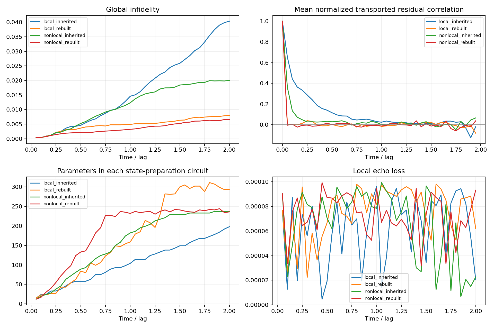

# Rebuild ansatz every step: t=0..2

## Protocol

Every step uses the previous accepted variational state as propagation input. Its old circuit is frozen in the echo target. The candidate state-preparation ansatz starts from the Neel product state, empty operator sequence and zero parameters; no previous parameters or generators are copied. The trajectory itself is NOT reset to the exact state. Inherited runs also reoptimize all existing candidate angles: they inherit structure and initialization, not frozen old angles. Only the input/reference circuit is frozen within a step in both methods. No penalties. Same midpoint Suzuki2 reps2, dt=.05, local-cost threshold 1e-4, L-BFGS-B max200 per growth round, gtol1e-5. Pool definitions and ordering match inherited runs. Rebuilt runs allow at most 100 growth rounds versus 30 in inherited runs; actual maxima are recorded below.

The local echo objective depends on the reference circuit representation as well as the target state. Rebuilding therefore changes both the optimization path and subsequent echo geometry. This experiment tests the complete rebuild strategy, not a uniquely isolated causal effect of circuit inheritance.

|Method|Global infidelity (%)|Residual diagonal sum|Cross terms|Amplification|Final parameters|Optimizer iterations|
|---|---:|---:|---:|---:|---:|---:|
|local_inherited|4.03437|0.005910182|0.03462582|6.8587|198|6618|
|nonlocal_inherited|2.00465|0.006543419|0.01345914|3.0569|237|8417|
|local_rebuilt|0.80049|0.007457513|0.0004576166|1.0614|294|196543|
|nonlocal_rebuilt|0.65763|0.007499296|-0.0009501661|0.8733|236|156169|

## Lag correlations

|Method|rho(.05)|rho(.25)|rho(.5)|rho(1.0)|
|---|---:|---:|---:|---:|
|local_inherited|0.65424|0.28741|0.11625|0.02464|
|nonlocal_inherited|0.36237|0.02750|0.02814|0.00217|
|local_rebuilt|0.00612|0.03918|0.00313|-0.01639|
|nonlocal_rebuilt|-0.00443|-0.00314|0.00260|-0.01236|

## Final circuit costs

|Pool|Compiled CX|Compiled depth|Max growth rounds|Number of parameter-count decreases|
|---|---:|---:|---:|---:|
|local_rebuilt|224|244|61|11|
|nonlocal_rebuilt|1077|940|58|13|
|local_inherited|142|142|4|0|
|nonlocal_inherited|974|842|5|0|

The first gtol=5e-5 local rebuild attempt failed its 100-round cap at t=1.0 with local cost 1.063229e-4, and its nonlocal counterpart was interrupted for matched reruns. These partial attempts are preserved but excluded from this table. All four reported trajectories use gtol=1e-5.

Residuals use recursive phase alignment and backward transport by the shared discrete propagator. The residual sum reconstruction is checked to 1e-9. Vector-error squared and infidelity are different quantities. Single deterministic trajectories, no statistical independence/significance claim. Optimization and stopping errors are included. Final circuit compilation uses rz/sx/x/cx, line coupling, level3, seed42; routing permutation is undone for the independent state check. Full exact reference is used only for evaluation. All accepted steps pass local-cost gates; final QASM and reference errors are checked separately.

Run: `python run_moment_apvqd.py --mode baseline --pool local --rebuild-every-step --max-growth-rounds 100 --gradient-tolerance 0.00001 --out OUTPUT`; replace local with nonlocal for the other pool.

Direct midpoint Suzuki propagation without variational projection has t=2 infidelity 7.0339854e-06 versus the continuous exact reference.

## 结果解读

在这套 8 比特、无惩罚的测试中，每步从 Néel 态重新构建候选线路，明显削弱了残差跨步的正向强化。它不重置物理轨迹，也不使用精确态参与拟合。

local：最终 infidelity 从 4.0344% 降至 0.8005%；残差对角和增大 26.18%，交叉项从 0.03462582 变为 0.0004576166，放大比从 6.859 降至 1.061。总优化迭代增加至原来的 29.70 倍。

nonlocal：最终 infidelity 从 2.0047% 降至 0.6576%；残差对角和增大 14.61%，交叉项从 0.01345914 变为 -0.0009501661，放大比从 3.057 降至 0.873。总优化迭代增加至原来的 18.55 倍。

因此最终误差改善主要与跨步强化减弱/抵消相一致，而非单步残差更小。nonlocal 重建版的交叉项总和为负，表示净抵消，不能称为独立随机误差。结构、初值、参考回波几何以及额外优化工作量均有变化，不能单独证明继承旧结构必然产生正相关。初始 5e-5 梯度阈值下的失败试验未混入最终四组结果；最终四组统一使用 1e-5。

GitHub includes completed trajectories plus status/results diagnostics for the two initial partial attempts; full partial trajectories remain in the original workspace. Postprocessing scripts use repository-relative paths and the shared exact_reference_t2.npz.
