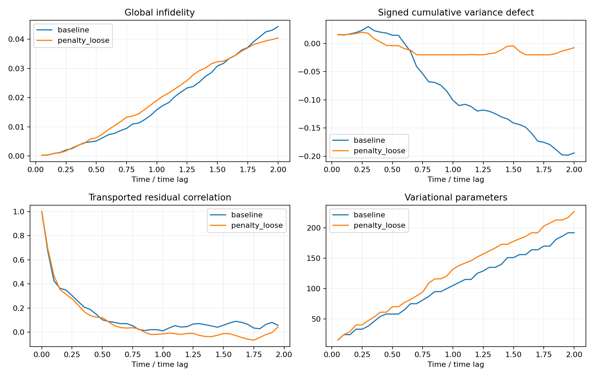

# Magnus-5 累计矩惩罚：t=0 到 2

采用 PRL 133, 010603 (2024) Eq. (1) 的 K^[5]，8 点 Gauss–Legendre 积分，逐区间更新。均值和方差均除以 N=8，历史累计为有符号和。初态为 Néel 态，原始 45 算符池，dt=0.05，中点 Suzuki 二阶 reps=2。

基线与惩罚版本都使用 L-BFGS-B（每轮最多 200 次）。惩罚版本另有硬约束 SLSQP 精修（每次最多 200 次），不达标才加算符；精修在可行域内最小化局域拟合损失，此时指定 hinge 惩罚为零。额外迭代计入成本。原仓库 ADAM 入口未覆盖，因此本表应在新入口各分支之间比较。

lambda_E=lambda_V=0.01；penalty 的两个预算为 0.002，penalty_loose 为 0.02。这些是探索参数，没有使用精确态挑选在线参数。精确 ODE 只用于事后评价。

|版本|终点|全局 infidelity|参数数|原始 CX|编译 CX / 深度|总优化迭代|
|---|---:|---:|---:|---:|---:|---:|
|baseline|2.00|4.4341%|192|224|124 / 117|2623|
|penalty_loose|2.00|4.0440%|227|250|157 / 164|14416|

编译统一使用 rz/sx/x/cx、8 位线性双向耦合、optimization_level=3、seed=42、固定初始布局；编译态误差独立检查。

|版本|累计能量偏差最大绝对值|累计方差偏差最大绝对值|残差平方和|跨步交叉项|总向量误差平方 / 对角和|
|---|---:|---:|---:|---:|---:|
|baseline|0.0195161|0.198272|0.00607787|0.0384644|7.3286|
|penalty_loose|0.02|0.02|0.00670473|0.0339914|6.0698|

残差按每步目标进行相位对齐，并由同一中点 Suzuki 离散传播反向输运到 t=0。跨步 Gram 矩阵求和与最终相位固定向量误差满足离散望远镜恒等式；此向量误差不同于相位不变 infidelity。每个版本使用同一传播器。相关系数是单条确定性轨迹的描述量，无统计显著性推断。

|版本|rho(0.05)|rho(0.25)|rho(0.5)|rho(1.0)|
|---|---:|---:|---:|---:|
|baseline|0.66943|0.30333|0.10228|0.01014|
|penalty_loose|0.69167|0.27671|0.11998|-0.01441|

## 实现与检查

新增代码位于仓库 moment_constraints.py、moment_statevector.py、run_moment_apvqd.py、analyze_moment_apvqd.py；运行方法见仓库 MOMENT_APVQD.md。

检查通过：K 的厄米性、静态极限、8/12 点积分一致性、Magnus 步长缩放、组合损失梯度、硬约束 Jacobian、Qiskit 回波、矩的参数移位、零惩罚回归、拒绝提交。最终轨迹另检查独立参考、抽样区间的矩更新、最终 QASM、编译保真度及所有接受门槛。

Magnus 传播的态矢量误差在 h=0.2/0.1/0.05 分别约 1.346e-5 / 1.050e-7 / 8.294e-10（t=0.4 起始）。K 有 207 个 Pauli 项，K² 有 3744 项（化简后，非测量组数）。

## 限制与保留的尝试

这是无 shots 的态矢量实验：矩以稀疏矩阵乘法求值，梯度采用伴随法加速。尚未实现真实硬件、测量分组、shots 分配或统计接受条件。不能把两个矩约束当作全局态保真度证书；必须结合最终误差与资源成本判断。

紧预算 penalty 运行因计算开销主动停止，最后接受时间为 0.65，未纳入到 2 的完整比较；不能据此判断约束不可行。penalty_soft_only 是最初仅软惩罚尝试：在 t=0.2 因方差累计偏差 0.002000064 超过 0.002 被拒绝，未完成到 2。*_slow_partial 是精修数值实现调整前保留的中间结果，不纳入完整比较。status.json 标明各正式运行是否完成。

原始数据：各目录 results.json、trajectory.npz、topology.json、final.qasm、correlation.csv、residuals.npz；汇总 summary.json；检查 validation.json / output_validation.json；来源 provenance.json。

## 结果解读

完成到 t=2 的预算 0.02 版本，全局 infidelity 从 4.4341% 降至 4.0440%，相对降低 8.80%。编译 CX 从 124 增至 157，深度从 117 增至 164，总优化迭代从 2623 增至 14416。因此不能声称资源效率改善。

残差交叉项从 0.0384644 降至 0.0339914，降低 11.63%；单步残差平方和却增大 10.31%。放大比从 7.329 降至 6.070，仍显著高于 1。这支持误差强化有所缓解，不能说误差已成为独立随机误差。此对照同时引入约束精修及额外门数，没有独立消融其贡献。

GitHub 中仅包含完成到 t=2 的 baseline 与 penalty_loose 数据；中断和失败的探索运行保留在原工作区，未随提交发布。
